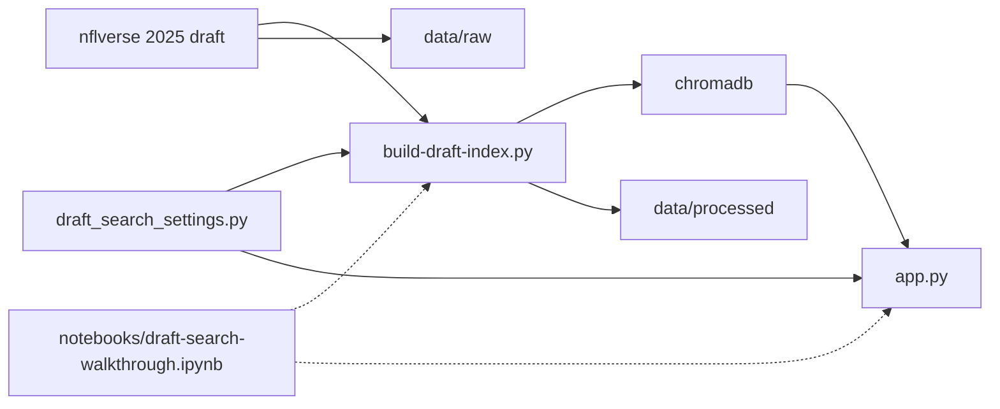

# Semantic search engine

Search the 2025 NFL draft by meaning. The app embeds a question with MiniLM, looks up the nearest picks in Chroma, and shows them in Gradio.

The dataset is the 2025 season from nflverse, 257 picks. The file itself is every draft since 1980. This project keeps `season == 2025`.

nflverse: https://github.com/nflverse/nflverse

Exact file: https://github.com/nflverse/nflverse-data/releases/download/draft_picks/draft_picks.parquet

## Contents

| Section | What it covers |
| --- | --- |
| [Architecture](#architecture) | How the draft, the build, Chroma, and the app connect |
| [Glossary](#glossary) | Terms used in this project |
| [Data](#data) | Raw table and cleaned sentences |
| [Run](#run) | Install, build the index, open the app |
| [Design manifest](#design-manifest) | How Cursor was used |

## Architecture



| Piece | What it is |
| --- | --- |
| `data/raw` | The nflverse draft table, unchanged |
| `scripts/build-draft-index.py` | Turns each pick into a sentence, embeds it, writes Chroma |
| `data/processed` | Those sentences, saved so the cleaned text is visible |
| `chromadb` | The vector database the app searches |
| `app.py` | The search page. It embeds the question and reads `chromadb` |
| `draft_search_settings.py` | Shared settings for the build script and the app: model, database folder, collection name, result count, and draft year |
| `notebooks/semantic_search_starter_notebook.ipynb` | Starter notebook: three toy sentences and an in-memory Chroma client |
| `notebooks/draft-search-walkthrough.ipynb` | The same steps as the build script and `app.py`, in notebook cells |

## Glossary

Terms used in this project.

| Term | Meaning |
| --- | --- |
| Dataset | The records you search. Here, the 2025 nflverse draft, 257 picks. |
| nflverse | The NFL data project at https://github.com/nflverse/nflverse. This app uses https://github.com/nflverse/nflverse-data/releases/download/draft_picks/draft_picks.parquet. |
| Chunk | The piece of text stored for one result. Here, one sentence per draft pick. |
| Embed | Turn text into a list of numbers with a model, so similar meanings land near each other. |
| Embedding | The list of numbers for one sentence. This model uses 384 numbers. |
| MiniLM | The embedding model, `sentence-transformers/all-MiniLM-L6-v2`. The same model must build the index and answer the query. |
| Vector | One embedding. Chroma stores a vector for every chunk. |
| Vector database | A store built to find the nearest vectors. This project uses Chroma. |
| Chroma | The vector database. The saved copy is `chromadb/chroma.sqlite3`. |
| Collection | A named set of vectors inside Chroma. This one is `draft_2025`. |
| Cosine distance | How Chroma scores a match. Smaller means the query and the pick are closer in meaning. |
| Semantic search | Search by meaning. The query does not have to reuse the exact words in the sentence. |
| Gradio | The search page. One text box in, the nearest picks out. |
| Hugging Face Spaces | The host for the published app. `README.md` starts with the Space settings. |

## Data

`data/` holds the exact tables this project used. The raw file is the nflverse download. The processed file is the cleaned text that was embedded.

| File | What it is |
| --- | --- |
| `data/raw/draft-picks-2025.csv` | The 2025 rows from https://github.com/nflverse/nflverse-data/releases/download/draft_picks/draft_picks.parquet, 257 picks, as loaded by `load_draft_picks(2025)`. Position values are still short codes such as `QB`. |
| `data/processed/indexed-draft-sentences-2025.csv` | One sentence per pick, after the codes were written out (`QB` becomes `quarterback`), empty names and colleges were filled, and round numbers were written as words. These sentences are what Chroma stores. |

`chromadb/chroma.sqlite3` is that sentence file embedded and saved. The app reads the database. It does not read the CSV files at search time.

## Run

```bash
python -m venv .venv
```

```bash
source .venv/bin/activate
```

```bash
pip install -r requirements.txt
```

```bash
python scripts/build-draft-index.py
```

```bash
python app.py
```

The build script only needs to run again if `draft_search_settings.py` changes. That file holds the model name, database folder, collection name, result count, and draft year.

Try the examples in the search box: quarterback, wide receiver, kicker, defensive end. A smaller distance is a closer match.

## Design manifest

This project was built with AI-driven development via Cursor, which was used for drafting scripts, data cleaning, the app, config, docs, and the saved search index.
