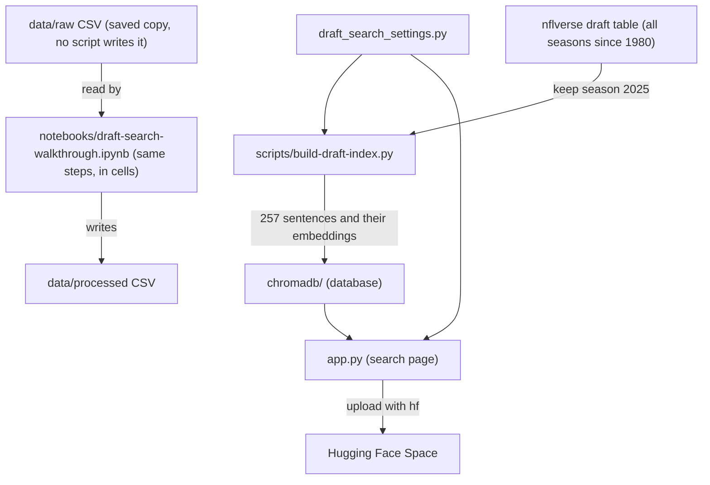

# Semantic Search Engine for the 2025 NFL Draft

This project is a search page for the 2025 NFL draft (**257** picks). You type a question such as "quarterback". The page returns the five picks whose one-sentence descriptions are closest in meaning, even when the words differ. It is built with the MiniLM embedding model, the Chroma vector database, and Gradio, and it is published as a Hugging Face Space. The terms are defined in the [glossary](docs/index.md#glossary).

- Space page: https://huggingface.co/spaces/jconnors23/nfl-draft-search-2025
- Direct app address: https://jconnors23-nfl-draft-search-2025.hf.space

## Contents

| Section | What it covers |
| --- | --- |
| [Architecture](#architecture) | How the data, the build, the database, and the app connect |
| [Data](#data) | Where the data comes from and which files hold it |
| [Run](#run) | Install, start the app, rebuild the database |
| [Where to Read Next](#where-to-read-next) | The documentation pages, in reading order |
| [How This Project Was Built](#how-this-project-was-built) | Which tool did which part |

## Architecture



```text
.
├── README.md                      Space settings and this overview
├── app.py                         The search page
├── draft_search_settings.py       Settings shared by the build and the app
├── requirements.txt               Pinned packages
├── scripts/
│   └── build-draft-index.py       Builds chromadb/ from the nflverse download
├── chromadb/                      The saved database the app reads
├── data/
│   ├── raw/draft-picks-2025.csv   The 2025 rows of the nflverse table, 36 columns
│   └── processed/indexed-draft-sentences-2025.csv   The 257 embedded sentences
├── notebooks/
│   └── draft-search-walkthrough.ipynb   The same steps, one cell at a time
└── docs/                          The documentation pages
```

## Data

The data is the NFL draft table from nflverse (https://github.com/nflverse/nflverse), downloaded from https://github.com/nflverse/nflverse-data/releases/download/draft_picks/draft_picks.parquet. The file covers every draft since 1980. This project keeps the 2025 season, 257 picks. The nflverse-data repository is published under the CC-BY-4.0 licence, according to its GitHub page, and this project credits nflverse as the source.

The app reads only `chromadb/`. It does not read the CSV files. For what each file holds, and a reference for every column, see [Build the Search Index](docs/build-the-index.md#data-files-and-column-reference).

## Run

You need Python 3.13 and internet access on the first run. Requirements, expected output, and publishing steps are in [How to Run and Publish](docs/how-to-run.md).

```bash
python -m venv .venv
```

```bash
source .venv/bin/activate
```

```bash
pip install -r requirements.txt
```

```bash
python app.py
```

The repository already contains a built database, so the app starts without a build. The page opens at http://127.0.0.1:7860. Rebuild after changing the model name, database folder, collection name, or draft year in `draft_search_settings.py`. `N_RESULTS` does not need a rebuild. Stop the app first, then run:

```bash
python scripts/build-draft-index.py
```

## Where to Read Next

| Page | What it covers |
| --- | --- |
| [Project Overview](docs/index.md) | The five steps, the data source, the file reference, and the glossary |
| [Build the Search Index](docs/build-the-index.md) | How each pick becomes a sentence and an embedding, and the column reference |
| [Search App and Hugging Face Space](docs/search-app-and-space.md) | How a search works and how the Space starts |
| [How to Run and Publish](docs/how-to-run.md) | Requirements, commands, expected output, and the upload steps |
| [Example Searches](docs/example-searches.md) | Real results, including searches that work poorly |
| [Conclusions](docs/conclusions.md) | What the search does well, what it does not do, and how to extend it |

## How This Project Was Built

| Stage | Tool | What it handled |
| --- | --- | --- |
| Code and configuration | Cursor | The build script, the app, the settings file, `requirements.txt`, the walkthrough notebook's code, the data cleaning, and the saved search index |
| Comments and documentation | Kiro | The code comments, this README, and the pages in `docs/` |
