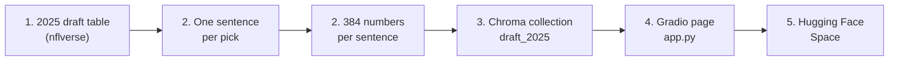

# Project Overview

This project is a search page for the 2025 NFL draft (**257** picks). You type a question such as "quarterback", and the page returns the five picks whose one-sentence descriptions are closest in meaning to it, even when the words differ. It is written for readers learning how to combine an embedding model, the Chroma database, and Gradio, and it is published as a Hugging Face Space.

- Space page: https://huggingface.co/spaces/jconnors23/nfl-draft-search-2025
- Direct app address: https://jconnors23-nfl-draft-search-2025.hf.space

## How the Project Fits Together

The project follows the five steps of the assignment.

| Step | What happens | Where it is explained |
| --- | --- | --- |
| 1. Pick a dataset | Download the 2025 NFL draft table from nflverse | [Where Does the Data Come From?](#where-does-the-data-come-from) |
| 2. Chunk and embed | Write one sentence per pick, then turn each sentence into 384 numbers | [Build the Search Index](./build-the-index.md) |
| 3. Store in Chroma | Save the sentences and their numbers in the `draft_2025` collection | [Build the Search Index](./build-the-index.md) |
| 4. Build the search app | A Gradio page in `app.py` | [Search App and Hugging Face Space](./search-app-and-space.md) |
| 5. Publish | Upload the project folder to a Hugging Face Space | [How to Run and Publish](./how-to-run.md) |

The build script and the app read three shared values from `draft_search_settings.py`: `MODEL_NAME`, `DB_DIR`, and `COLLECTION_NAME`. If the app uses a different `MODEL_NAME`, it still runs, but the distances are meaningless. If `DB_DIR` or `COLLECTION_NAME` differ, the app stops with an error because it cannot find the collection.

## Where Does the Data Come From?

The data is the NFL draft table published by the nflverse project (https://github.com/nflverse/nflverse). The exact file is https://github.com/nflverse/nflverse-data/releases/download/draft_picks/draft_picks.parquet.

The download covers every draft since 1980. The build script keeps the 2025 rows only, **257** picks, one row per drafted player. The player fields are recorded from Pro Football Reference.

The nflverse-data repository is published under the CC-BY-4.0 licence, according to its GitHub page. This project reuses its data with credit to nflverse.

## File Reference

| Path | What it is |
| --- | --- |
| `draft_search_settings.py` | Shared settings: model name, database folder, collection name, result count, draft year |
| `scripts/build-draft-index.py` | Downloads the draft, writes one sentence per pick, embeds the sentences, saves the Chroma database |
| `app.py` | The search page. Embeds the question, asks Chroma for the closest sentences, shows them |
| `chromadb/` | The saved Chroma database. Kept in git so the Space can use it |
| `data/raw/draft-picks-2025.csv` | The 2025 rows of the nflverse table, all 36 columns |
| `data/processed/indexed-draft-sentences-2025.csv` | The 257 sentences that were embedded, with their ids |
| `notebooks/draft-search-walkthrough.ipynb` | The same build and search steps, one cell at a time |
| `requirements.txt` | Pinned packages for the build, the app, and the Space |

## Glossary

| Term | Meaning |
| --- | --- |
| Chunk | The piece of text stored and returned as one result. Here, one sentence per draft pick. |
| Embed | Turn text into a list of numbers with a model, so texts with similar meaning get similar lists. |
| Embedding | The list of numbers a model produces for one sentence. This model produces **384** numbers per sentence. |
| Normalize | Scale an embedding to length 1. The build script and `app.py` both do this (`normalize_embeddings=True`). |
| MiniLM | The embedding model, `sentence-transformers/all-MiniLM-L6-v2`. The same model must build the database and embed the question. |
| Chroma | The vector database: a store built to find the embeddings closest to a given one. Its saved files are in `chromadb/`. |
| Collection | A named set of embeddings inside Chroma. This one is `draft_2025`. |
| Cosine distance | The number Chroma returns for each match. 0 means the same direction, and larger numbers mean less similar text. Smaller is a better match. |
| Semantic search | Search by meaning. The question does not have to reuse the exact words in the sentence. |
| Gradio | A Python library that builds a web page around a function. Here the page has one text box for the question and one for the results. |
| Hugging Face Space | A hosted app on huggingface.co. `README.md` starts with the settings the Space reads. |
