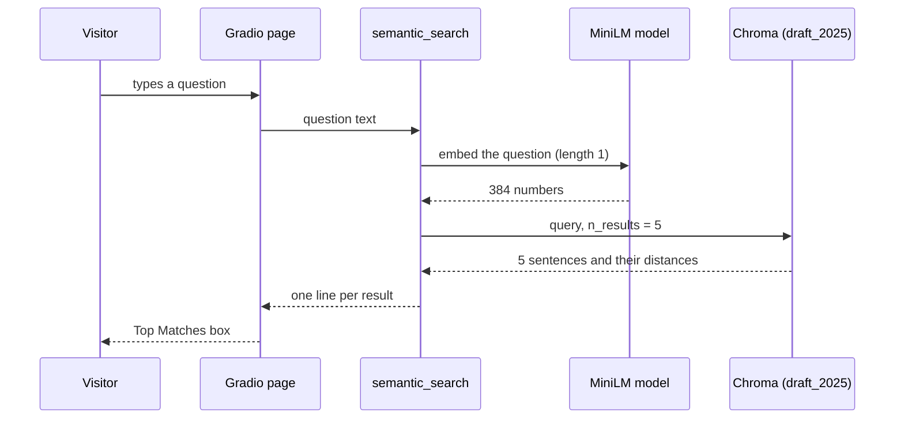

# Search App and Hugging Face Space

`app.py` is the search page. It reads the saved Chroma database and never rebuilds it. The same file runs on your computer and on the Hugging Face Space. For the commands to start it or upload it, see [How to Run and Publish](./how-to-run.md).

## How a Search Works



When the page starts, `app.py` loads the embedding model, opens the saved database in `DB_DIR`, and gets the collection named by `COLLECTION_NAME` (`draft_2025`). On each search, `semantic_search` embeds the question, asks Chroma for the **5** closest sentences (`N_RESULTS`), and returns one line per result: the distance, then the stored sentence. An empty question returns a hint instead of a search.

## Step 4: Build the Search Page With Gradio

Gradio builds the web page around `semantic_search`. `gr.Interface` takes one text box and returns one text box. It calls `semantic_search` and shows the string it returns. Gradio itself does not embed text or talk to Chroma.

| `gr.Interface` argument | What the visitor sees |
| --- | --- |
| `title` | Semantic Search Engine |
| `description` | "Search the 2025 NFL draft.", the nflverse download link, and "A smaller distance is a closer match." |
| input label | Enter your search query |
| output label | Top Matches |
| `examples` | quarterback, wide receiver, kicker, defensive end |

`demo.launch()` runs only when the file is started as `python app.py`. Locally the page is at http://127.0.0.1:7860.

`requirements.txt` installs `chromadb`, `gradio`, and `sentence-transformers` for the app. `nflreadpy` and `polars` are for the build script only. The Space installs them too, because it installs the whole file.

## Step 5: Publish to a Hugging Face Space

A Hugging Face Space is its own Git repository on huggingface.co. It is not connected to the GitHub repository. Uploading the project folder with `hf upload` is what updates the Space. A push to GitHub does not.

The first lines of `README.md` must be a settings block between two lines of `---`. Hugging Face reads it to decide how to start the Space:

```yaml
---
title: nfl-draft-search-2025
sdk: gradio
sdk_version: 6.32.0
python_version: "3.13"
app_file: app.py
short_description: Semantic search of 2025 NFL draft, data sourced via nflverse
---
```

`sdk_version` and `python_version` make the Space use the same Gradio and Python versions as the local setup. Without them, the Space uses Python 3.10 by default, according to the Hugging Face Spaces configuration reference.

The Space installs `requirements.txt` and runs `app.py`. On the first start it installs PyTorch and downloads MiniLM, so the **App** tab can show "Starting" for a few minutes. Later starts reuse the cached model.

Visitors who open the Space page see the search page in the **App** tab: the title, the description, one search box, four example questions, and five results after a search. The **Files** tab lists the uploaded project files. The Space page and the direct app address (both listed on the [Project Overview](./index.md)) stay the same after an update, as long as the Space name does not change.
